<p align="center">
  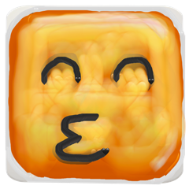
</p>

<h1 align="center">EmojiPainter</h1>
<p align="center"><strong>A creative painting platform, not just an emoji app.</strong></p>

<p align="center">
  <a href="LICENSE"></a>
  <a href="https://github.com/senderpa/EmojiPainter/releases/latest"></a>
  
  
</p>

<p align="center">
  <a href="https://emojipainter.com/emoji_paint/index.html"><strong>🎨 Open the online test painter ↗</strong></a><br/>
  <sub>A lightweight browser pilot with painting and timelapse replay. It shares core functions with the iOS and Mac apps, but is not the full native app.</sub>
</p>

<p align="center">
  <a href="https://emojipainter.com/">🌐 Website</a> ·
  <a href="https://emojipainter.com/public/gallery.html">🖼️ Community gallery</a> ·
  <a href="https://apps.apple.com/us/app/emoji-painter/id6753342820">📱 iPhone / iPad — Free</a> ·
  <a href="https://apps.apple.com/us/app/emoji-paint/id6753338528">💻 Mac — Free</a>
</p>

<p align="center">
  <a href="https://emojipainter.com/">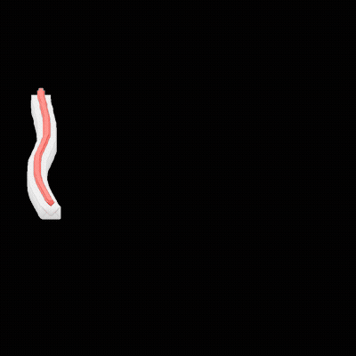</a>
</p>

---

EmojiPainter is a real-time mobile painting engine, reimagined around emoji as a brush medium
instead of flat color. It's a working reference implementation for several things that don't
usually live in one open-source project: a tile-cached GPU 2D canvas, touch/stylus smudge and
compositing, an infinite vector canvas, frame-based animation, and genuine spatial painting —
painting directly onto real walls and rooms in AR, including a native RoomPlan-driven 3D room
inspector.

It's built and maintained by one person — [see the creator note](#creator-note) — using modern
agentic coding tools to build further than a solo self-taught developer could otherwise reach.

> The browser pilot is the quickest way to try painting and timelapse replay. Click a painting
> below to open its community gallery post.

<p align="center">
  <a href="https://emojipainter.com/public/gallery.html?post=64&guess=1"><strong>🕵️ Try a live mystery painting challenge ↗</strong></a><br/>
  <sub>Open a real community painting in the browser and guess its hidden topic.</sub>
</p>

### 2026 community gallery highlights

<table>
  <tr>
    <td align="center" width="50%">
      <a href="https://emojipainter.com/public/gallery.html?post=94">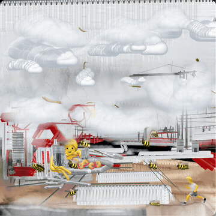</a><br/>
      <sub><a href="https://emojipainter.com/public/gallery.html?post=94">Wasp-Nest City · GIF · by Kakaduuu ↗</a></sub>
    </td>
    <td align="center" width="50%">
      <a href="https://emojipainter.com/public/gallery.html?post=93">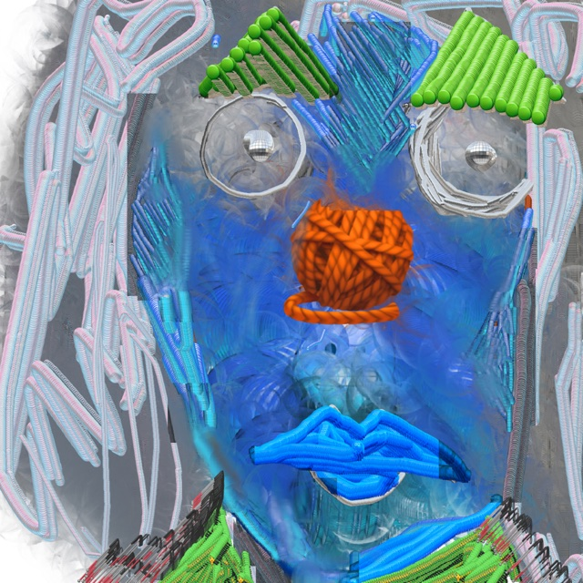</a><br/>
      <sub><a href="https://emojipainter.com/public/gallery.html?post=93">Ice Clown · community gallery ↗</a></sub>
    </td>
  </tr>
  <tr>
    <td align="center" width="50%">
      <a href="https://emojipainter.com/public/gallery.html?post=92">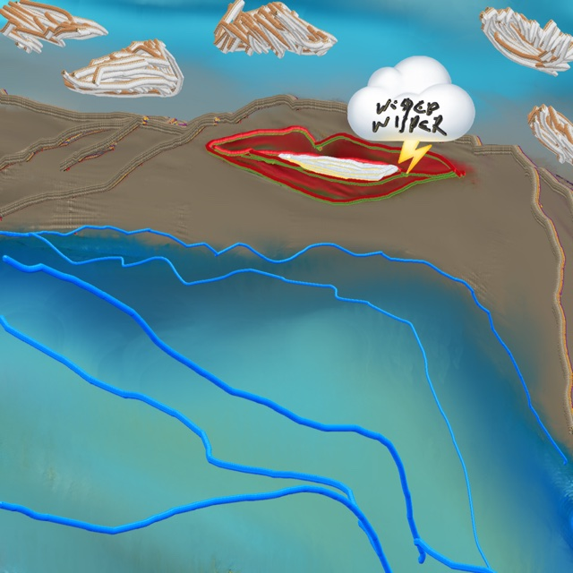</a><br/>
      <sub><a href="https://emojipainter.com/public/gallery.html?post=92">Whispering Cliffs · community gallery ↗</a></sub>
    </td>
    <td align="center" width="50%">
      <a href="https://emojipainter.com/public/gallery.html?post=89">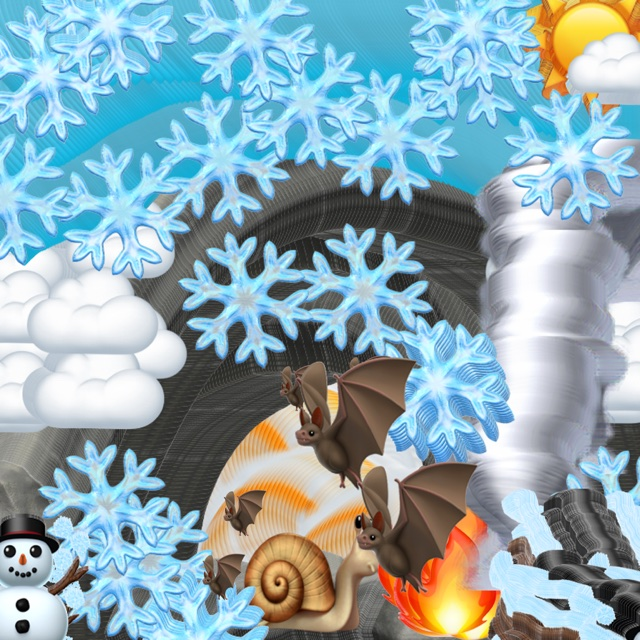</a><br/>
      <sub><a href="https://emojipainter.com/public/gallery.html?post=89">Rockpool Snail · community gallery ↗</a></sub>
    </td>
  </tr>
  <tr>
    <td align="center" width="50%">
      <a href="https://emojipainter.com/public/gallery.html?post=87">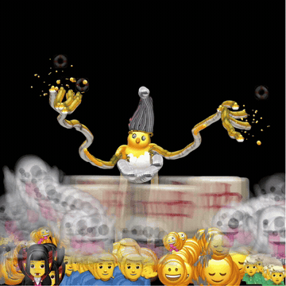</a><br/>
      <sub><a href="https://emojipainter.com/public/gallery.html?post=87">Disco Wizard · GIF · by Kakaduuu ↗</a></sub>
    </td>
    <td align="center" width="50%">
      <a href="https://emojipainter.com/public/gallery.html?post=79">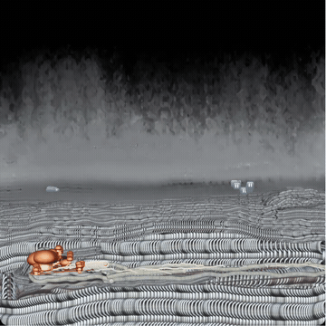</a><br/>
      <sub><a href="https://emojipainter.com/public/gallery.html?post=79">Adrift, pleasantly · GIF · by Kakaduuu ↗</a></sub>
    </td>
  </tr>
</table>

### 2025 community gallery archive

<table>
  <tr>
    <td align="center" width="50%">
      <a href="https://emojipainter.com/public/gallery.html?post=29">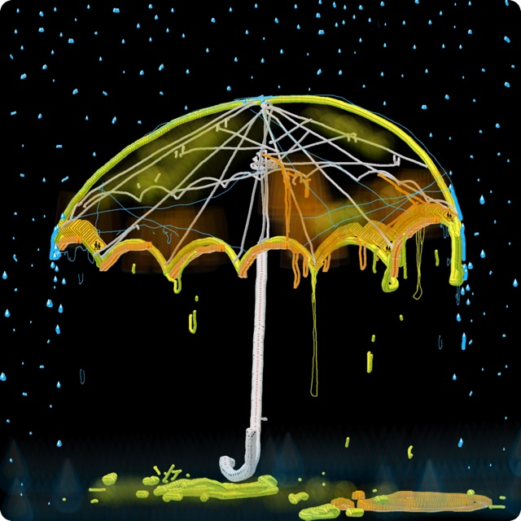</a><br/>
      <sub><a href="https://emojipainter.com/public/gallery.html?post=29">Dec 17, 2025 · Molten Umbrella · digitaldoodler39 · 17 min · 1 like ↗</a></sub>
    </td>
    <td align="center" width="50%">
      <a href="https://emojipainter.com/public/gallery.html?post=28">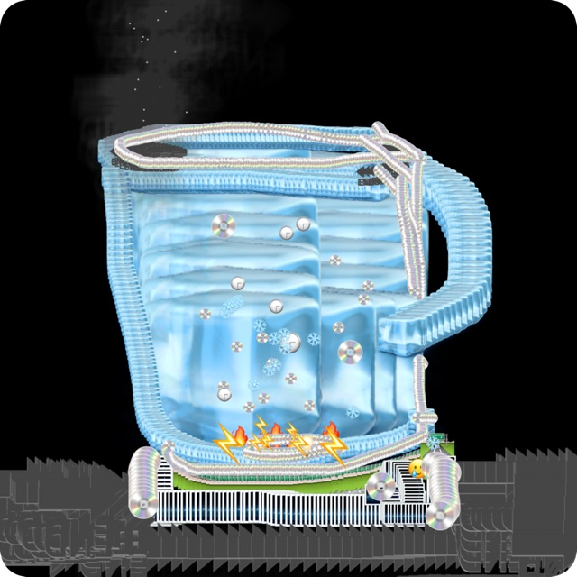</a><br/>
      <sub><a href="https://emojipainter.com/public/gallery.html?post=28">Dec 14, 2025 · Mechanical Canister · anonymous · 16 min · 2 likes ↗</a></sub>
    </td>
  </tr>
</table>

## What's actually in this repository

Everything below is verified against the source in this repo — nothing here is aspirational.

- **2D painting engine** — tile-cached GPU canvas (`src/engine/`, `src/workspace/`), built for
  real-time high-density stamping without frame drops.
- **AR / spatial painting** (`modules/emoji-ar/`) — paint directly onto real walls and surfaces via
  ARKit + RealityKit; on LiDAR devices, Apple RoomPlan captures the room and a native SceneKit
  "dollhouse" inspector lets you orbit the captured room with your painted strokes rendered on it
  at true scale, with shadow-casting lighting.
- **Vector mode** (`src/vector/`, `VectorDocumentCore/`) — an infinite Skia vector canvas backed by
  a dedicated Swift Package document core.
- **Frame animator** (`src/animation/`, `src/animator/`, `src/framer/`) — timeline-based animation
  over painted strokes.
- **Smudge/compositing brush engine** — CPU pixel smudging that carries real canvas color, not a
  filter.
- **Front-camera face painting** (`modules/emoji-ar/` face module) — on-device ARKit face tracking;
  no camera frames or face geometry ever leave the device.
- **Daily/mystery painting challenges + gallery** (`src/gesser/`, `backend/`, `.website_work/`) —
  a human-authored daily topic system (plus a "mystery" surprise-topic mode) with a public gallery
  and social/profile features, backed by the included PHP reference server.
- **Export** — finished paintings export as images/GIFs/video from the actual stroke data (not a
  fragile screen capture), so exports stay correct even for the native Metal/AR canvases.
- **Collaborative multiplayer canvas** (`src/multiplayer/`, `multi/`) — a standalone Node.js server
  for shared real-time canvases.

Full breakdown of what's included vs. intentionally excluded (and why):
[`docs/OPEN_SOURCE_BOUNDARY.md`](docs/OPEN_SOURCE_BOUNDARY.md).

## Architecture

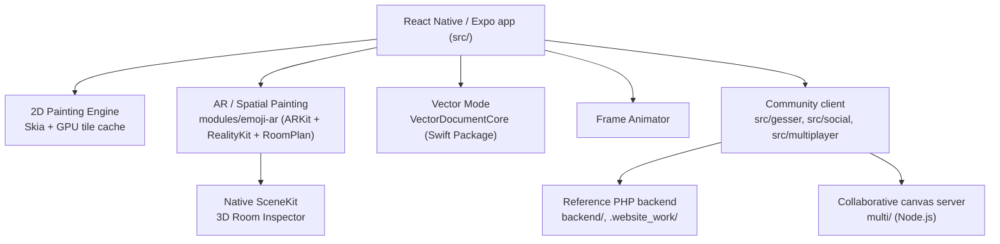

The tile renderer turns a saved stroke into repeated emoji stamps, caches the affected canvas
tiles, and redraws only the tiles touched by a change. The current `TilePaintCanvas` example covers
ordinary emoji strokes; smudge strokes are handled by a separate renderer in the app.

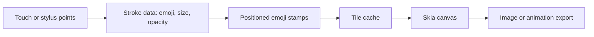

More detail: [`ARCHITECTURE.md`](ARCHITECTURE.md).

## Getting started

```bash
git clone https://github.com/senderpa/EmojiPainter.git
cd EmojiPainter
npm install
npx expo run:ios      # or: npx expo run:android
```

Full setup (Xcode/Android Studio requirements, native module notes, backend setup for the
community features): [`docs/BUILDING.md`](docs/BUILDING.md).

To embed the existing renderer in another React Native screen, start with
[`docs/REUSING_THE_ENGINE.md`](docs/REUSING_THE_ENGINE.md) and its small component example. The
renderer is currently source code inside this Expo app, not a separately published package.

Read [VISION.md](VISION.md) for the artistic motivation and future direction.

## Status & roadmap

This is a young open-source release of a ~1.5-year-old production app. See
[`ROADMAP.md`](ROADMAP.md) for what's next and [`CHANGELOG.md`](CHANGELOG.md) for release history.

## Contributing

Contributions are welcome — see [`CONTRIBUTING.md`](CONTRIBUTING.md) and
[`CODE_OF_CONDUCT.md`](CODE_OF_CONDUCT.md). Security issues: see [`SECURITY.md`](SECURITY.md)
rather than filing a public issue.

## Creator note

EmojiPainter is built by Pascal Sender, a Swiss visual artist whose practice has long combined
physical painting, augmented reality, and hand-built software — previously hand-coding AR software
connected to his
painting practice, and now building this as a public, open creative tool rather than a closed
production app. Modern agentic coding tools materially expanded what was buildable solo.

## License

Apache License 2.0 — see [`LICENSE`](LICENSE) and [`NOTICE`](NOTICE). Third-party dependency
licenses: [`THIRD_PARTY_NOTICES.md`](THIRD_PARTY_NOTICES.md).

---

### The Icon, Reimagined

Nine randomly selected animated looks from the EmojiPainter icon lab. Each loops; open the
[live homepage](https://emojipainter.com/) for a different random selection.

<table>
  <tr>
    <td align="center" width="33%"><a href="https://emojipainter.com/">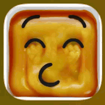</a></td>
    <td align="center" width="33%"><a href="https://emojipainter.com/">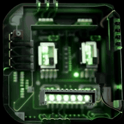</a></td>
    <td align="center" width="33%"><a href="https://emojipainter.com/">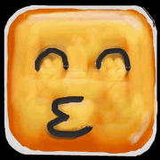</a></td>
  </tr>
  <tr>
    <td align="center"><a href="https://emojipainter.com/">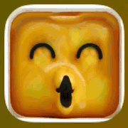</a></td>
    <td align="center"><a href="https://emojipainter.com/">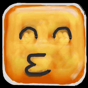</a></td>
    <td align="center"><a href="https://emojipainter.com/">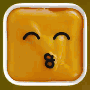</a></td>
  </tr>
  <tr>
    <td align="center"><a href="https://emojipainter.com/">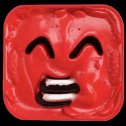</a></td>
    <td align="center"><a href="https://emojipainter.com/">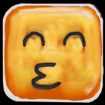</a></td>
    <td align="center"><a href="https://emojipainter.com/">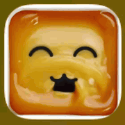</a></td>
  </tr>
</table>
